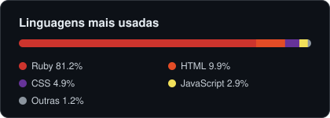

# Anderson Furlane Martins

**Tech Manager na Blu · Software Engineer · Ruby desde 2012**

📍 Vila Velha, ES — Brasil

---

### 👋 Sobre mim

Mais de 10 anos construindo software com **Ruby**. Hoje lidero a equipe de tecnologia da **Blu** como Tech Manager, apoiando o time na entrega de sistemas robustos e integrados com **Ruby, Sidekiq, Kafka e APIs REST**, sempre alinhados às necessidades do cliente e aos objetivos do negócio.

Meu foco é colaboração e excelência técnica: um ambiente que valorize inovação e crescimento profissional.

### 💡 O que eu faço

- **Liderança de engenharia e produto** — formo e desenvolvo times, conduzo decisões técnicas e equilibro prazo, qualidade e impacto no negócio.
- **Arquitetura de sistemas** — desenho soluções que crescem junto com o produto, das primeiras linhas de código à operação em produção.
- **Integrações e processamento assíncrono** — mensageria orientada a eventos, filas de jobs e APIs que conectam sistemas de forma confiável.
- **Dados com consistência** — modelagem e evolução de bancos relacionais em sistemas que não podem errar.
- **Automação e IA aplicada** — uso de modelos de linguagem e automações para tirar trabalho repetitivo das pessoas e acelerar entregas.
- **Desenvolvimento de pessoas** — mentoria, revisão de código e cultura de aprendizado contínuo.

### 🛠️ Stack

  
  
  
  
  
  
  
  

### 💼 Trajetória

| Período | Cargo | Empresa |
|---|---|---|
| 2021 – hoje | **Tech Manager** · Gerente de Engenharia e Produtos | Blu |
| 2017 – 2022 | Ruby Developer | Blu |
| 2015 – 2017 | Ruby Developer | ADTsys Software S.A. |
| 2014 – 2015 | Ruby on Rails & Android Developer | Grupo NZN |
| 2012 – 2015 | Ruby on Rails Developer | Click Jogos |

Quase 10 anos de Blu, de desenvolvedor a gestor da área de tecnologia.

### 🚀 Projetos em destaque

- **[import-payments](https://github.com/AndersonFurlane/import-payments)** — importação de pagamentos com Apache Kafka na AWS · `Ruby`
- **[dark-studio-site](https://github.com/AndersonFurlane/dark-studio-site)** — página institucional e política de privacidade do Dark Studio · `HTML`

### 🎓 Formação

- **Bacharelado em Ciência da Computação** — UNIP · 2010–2014
- **Tecnologia em Sistemas de Informação** — FAESA · 2007–2010

🌎 Português (nativo) · Inglês (profissional)
